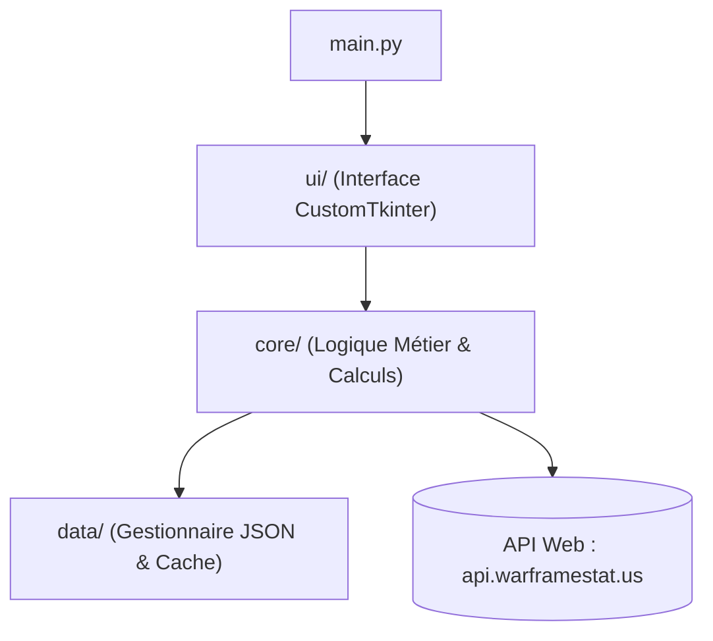

# 📋 Cahier des Charges (CDC) — Wireframe V1

> **Projet :** Wireframe V1 (Compagnon de suivi des timers et rotations pour *Warframe*)  
> **Plateforme :** Application de bureau Windows  
> **Langage & Technologies :** Python 3.10+ / CustomTkinter (UI) / Requests (API HTTP) / JSON (Stockage local)  
> **Objectif pédagogique :** Apprendre l'architecture logicielle modulaire (Séparation des responsabilités UI / Core / Data) et les bonnes pratiques Git.

---

## 1. Spécifications Fonctionnelles (Périmètre MVP — Version 1)

L'application **Wireframe V1** se concentre exclusivement sur le suivi temporel en direct (**Option B : Le Dashboard des Timers**). Elle permet à un joueur de Warframe de connaître l'état actuel des cycles du jeu sans avoir à lancer une mission.

### 1.1. Fonctionnalités incluses dans la V1 (MVP)
1. **Suivi des Cycles des Mondes Ouverts (`worlds_view`) :**
   - **Plaines d'Eidolon (Cetus - Terre) :** Affiche l'état actuel (*Jour* ou *Nuit*) et le compte à rebours dynamique (HH:MM:SS) avant le prochain changement.
   - **Vallée Orbis (Fortuna - Vénus) :** Affiche l'état actuel (*Chaud* ou *Froid*) et le compte à rebours dynamique.
   - **Puy de Cambion (Necralisk - Deimos) :** Affiche le cycle actif (*Fass* ou *Vome*) et le compte à rebours dynamique.
2. **Suivi des Rotations du Circuit de Duviri (`duviri_view`) :**
   - Affiche les **3 Warframes** disponibles cette semaine dans le Circuit standard.
   - Affiche les **5 Armes Incarnon** disponibles cette semaine dans le Circuit *Route de l'Acier*.
   - Affiche le compte à rebours avant la réinitialisation hebdomadaire (chaque lundi à 00h00 UTC).
3. **Suivi du Marchand du Néant — Baro Ki'Teer (`baro_view`) :**
   - Indique si Baro Ki'Teer est actuellement présent ou absent.
   - Indique le **Relais** de destination (ex: Relais Kronia, Larunda...).
   - S'il est absent : affiche le compte à rebours avant son arrivée.
   - S'il est présent : affiche le compte à rebours avant son départ ainsi que la liste de son inventaire actuel (objets, prix en Ducats et Crédits).
4. **Synchronisation Réseau & Mode Hors-Ligne (Cache) :**
   - Récupération des données officielles via l'API communautaire `https://api.warframestat.us/pc`.
   - Bouton **"Actualiser"** dans la barre latérale pour forcer une resynchronisation manuelle avec l'API.
   - Sauvegarde automatique de la dernière réponse API dans `data/cache.json` pour permettre à l'application de fonctionner (et de continuer les comptes à rebours) même en cas de coupure Internet temporaire.

### 1.2. Fonctionnalités reportées aux versions futures (Hors périmètre V1)
Pour éviter le *Scope Creep* et garantir la livraison d'une V1 propre :
- **Reporté en V2 (Codex de Farm) :** Encyclopédie et recherche des Ressources, des Warframes et des ~1200 Mods.
- **Reporté en V3 (Alertes & Mises à prix) :** Détail des rotations de mises à prix (Bounties) par planète et système de notifications Windows en arrière-plan.

---

## 2. Architecture Modulaire & Arborescence du Projet

Il est **strictement interdit** de coder l'application dans un fichier unique. Le projet respecte une architecture en 3 couches (**UI** $\rightarrow$ **Core** $\rightarrow$ **Data**).

```text
wireframe_v1/
│
├── .venv/                      # Environnement virtuel Python isolé (Ignoré par Git)
├── .gitignore                  # Fichiers et dossiers exclus du suivi Git
├── requirements.txt            # Dépendances externes (customtkinter, requests)
├── CDC.md                      # Le présent Cahier des Charges
├── main.py                     # Point d'entrée unique : instancie et lance l'application
│
├── data/                       # 📦 COUCHE DONNÉES (Stockage & Lecture JSON)
│   ├── __init__.py
│   ├── duviri_rotations.json   # Listes statiques officielles (11 sem. Warframes / 8 sem. Incarnons)
│   ├── cache.json              # Cache local de la dernière réponse API (Ignoré par Git)
│   └── data_manager.py         # Lecture/écriture sécurisée des fichiers JSON
│
├── core/                       # 🧠 COUCHE LOGIQUE MÉTIER (0% CustomTkinter)
│   ├── __init__.py
│   ├── api_client.py           # Requêtes HTTP vers api.warframestat.us et gestion des erreurs réseau
│   ├── timer_engine.py         # Calcul du temps restant (HH:MM:SS) à partir d'une date ISO/UTC
│   └── duviri_calculator.py    # Détermination de la rotation actuelle de Duviri (API + Calcul UTC)
│
└── ui/                         # 🎨 COUCHE INTERFACE GRAPHIQUE (100% CustomTkinter, 0% logique métier)
    ├── __init__.py
    ├── app_window.py           # Fenêtre principale (CTk) assemblant la Sidebar et le conteneur de vues
    ├── sidebar.py              # Menu latéral gauche (Navigation entre les 3 vues + bouton Actualiser)
    ├── components/             # Composants visuels génériques et réutilisables ("Moules à gâteaux")
    │   ├── __init__.py
    │   └── cycle_card.py       # Carte réutilisable (CTkFrame) affichant Titre + Statut + Timer
    └── views/                  # Les 3 écrans principaux affichés dans la zone droite
        ├── __init__.py
        ├── worlds_view.py      # Vue Mondes Ouverts (instancie 3 CycleCards : Cetus, Vallis, Cambion)
        ├── duviri_view.py      # Vue Circuit de Duviri (Warframes + Incarnons + Timer hebdo)
        └── baro_view.py        # Vue Baro Ki'Teer (Statut, Relais, Timer + Liste déroulante d'objets)
```

### Flux de communication (Règle des `import`)

* `ui/` peut importer `core/`.
* `core/` peut importer `data/`.
* **INTERDICTION ABSOLUE :** `core/` et `data/` ne doivent jamais importer `ui/` ni `customtkinter`.

---

## 3. 🚨 Règles d'Architecture pour l'IA (Directives Tech Lead)

> [!IMPORTANT]
> Ces règles s'appliquent à l'IA (Antigravity) et au développeur tout au long du projet. L'IA doit systématiquement vérifier et respecter ces contraintes avant d'écrire ou de modifier du code :

1. **Limite de taille stricte (~150 lignes max par fichier) :** Aucun fichier `.py` ne doit dépasser environ 150 lignes de code. Si un fichier grandit trop, il doit être découpé en sous-composants.
2. **Séparation stricte UI / Logique Métier :**
   - Aucun calcul de date, aucune manipulation mathématique de rotation et aucun appel réseau (`requests.get`) ne doit se trouver dans le dossier `ui/`.
   - Aucun widget graphique (`customtkinter`) ne doit être importé dans `core/` ou `data/`.
3. **Principe DRY (*Don't Repeat Yourself*) :** Utiliser des composants héritant de `CTkFrame` (comme `CycleCard`) plutôt que de dupliquer du code d'interface pour chaque planète.
4. **Zéro donnée "en dur" (No Hardcoding) :** Les listes de Warframes et d'armes Incarnon de Duviri doivent obligatoirement être chargées depuis `data/duviri_rotations.json` via `data/data_manager.py`.
5. **Anti-Spam API :** Ne **jamais** appeler l'API Internet chaque seconde. L'API est interrogée une fois au démarrage (ou via le bouton *Actualiser*), puis `core/timer_engine.py` calcule la décrémentation du compte à rebours localement chaque seconde (via la méthode `.after(1000, ...)` de CustomTkinter côté UI).
6. **Développement incrémental (Un module à la fois) :** Il est interdit de générer tous les fichiers du projet d'un seul coup. On code **un seul module à la fois**, on l'explique, on le teste ensemble dans le terminal ou à l'écran, on fait un commit Git, puis on passe au suivant.

---

## 4. Checklist d'Initialisation & Plan de Développement

Nous avancerons pas à pas en cochant cette liste au fur et à mesure :

### Phase 0 : Initialisation de l'environnement et de Git
- [x] **0.1.** Ouvrir le dossier `wireframe_v1` comme espace de travail (Workspace) dans Antigravity.
- [x] **0.2.** Créer l'environnement virtuel Python : `python -m venv .venv` et l'activer.
- [x] **0.3.** Créer le fichier `.gitignore` (excluant `.venv/`, `__pycache__/`, `data/cache.json`).
- [x] **0.4.** Créer le fichier `requirements.txt` (`customtkinter`, `requests`) et installer les paquets.
- [x] **0.5.** Initialiser Git (`git init`) et réaliser le premier commit (`docs: ajout du CDC et configuration initiale`).

### Phase 1 : La Couche Données (`data/`)
- [x] **1.1.** Créer `data/duviri_rotations.json` avec le calendrier officiel des 11 semaines de Warframes et 8 semaines d'Incarnons.
- [x] **1.2.** Coder `data/data_manager.py` (fonctions pour lire `duviri_rotations.json` et lire/écrire `cache.json`).
- [x] **1.3.** Tester `data_manager.py` dans le terminal et faire un commit Git.

### Phase 2 : Le Cerveau / Logique Métier (`core/`)
- [x] **2.1.** Coder `core/timer_engine.py` (convertir une date de fin UTC en texte `HHh MMm SSs` restant).
- [x] **2.2.** Coder `core/duviri_calculator.py` (calculer la semaine actuelle de Duviri et renvoyer les récompenses).
- [x] **2.3.** Coder `core/api_client.py` (interroger l'API Warframe pour Cetus, Vallis, Cambion et Baro + sauvegarde dans le cache).
- [x] **2.4.** Tester tout le dossier `core/` en mode console (sans interface graphique) et faire un commit Git.

### Phase 3 : L'Interface Graphique Modulaire (`ui/` & `main.py`)
- [x] **3.1.** Coder la coquille vide : `ui/sidebar.py`, `ui/app_window.py` et `main.py` pour afficher la fenêtre et tester les boutons du menu. (Commit Git).
- [x] **3.2.** Coder le composant réutilisable `ui/components/cycle_card.py` puis la vue `ui/views/worlds_view.py` et le panneau droit `ui/live_panel.py` connectés aux timers en direct. (Commit Git).
- [x] **3.3.** Coder la vue `ui/views/duviri_view.py` et `ui/views/welcome_view.py` (style maquette Nyxo_17). (Commit Git).
- [x] **3.4.** Coder la vue `ui/views/baro_view.py` pour afficher l'état et l'inventaire de Baro Ki'Teer. (Commit Git).

### Phase 4 : Finitions & Publication GitHub
- [ ] **4.1.** Vérification générale (coupure Internet simulée pour tester le cache, fluidité des timers).
- [ ] **4.2.** Création du fichier `README.md` et envoi (push) du projet propre sur GitHub.

