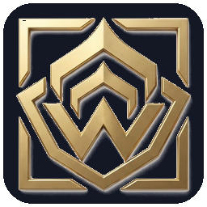

<div align="center">
  
  <h1>❖ WireFrame v1.0.24 — Warframe Companion App (HTML5 • 144 FPS) ❖</h1>
  <p>
    
    
    
    <a href="https://discord.gg/DhGwHPf82n"></a>
  </p>
  <p><b>Ultra-fast, zero-dependency, bilingual (EN / FR) desktop & web companion to track the Origin System in real time.</b></p>
  <p>Created by <a href="https://github.com/Nyxo-17"><b>Nyxo_17</b></a> • Current Release: <b><code>v1.0.24</code></b> • <a href="https://discord.gg/DhGwHPf82n">❖ Join the Discord Server</a></p>
  <p><a href="#-english-version"><b>🇬🇧 English Version</b></a> &nbsp;|&nbsp; <a href="#-version-française"><b>🇫🇷 Version Française</b></a></p>
</div>

---

# 🇬🇧 English Version

## ✨ Key Features

- ⚡ **144 FPS HTML5 / CSS3 Sci-Fi Engine**: Hardware-accelerated interface with genuine CSS3 Neon Glow effects and zero external runtime requirements.
- 🌍 **Live Planet & Open-World Cycles**: Real-time second-by-second countdowns for **Plains of Eidolon / Cetus** (Day/Night), **Orb Vallis / Fortuna** (Warm/Cold), **Cambion Drift / Deimos** (Fass/Vome), and **Earth Forests** (4h Cycle) featuring official Star Chart planet renders.
- 🌀 **The Duviri Circuit & Incarnon Tracker**: Displays current week, next week, and full rotation schedule for both **Steel Path Incarnon Weapons** (8-week loop) and **Normal Circuit Warframes** (11-week loop).
- 🎯 **Bounty Rotations (A / B / C)**: Live reward pool tracking across Cetus, Fortuna, Deimos, Zariman Ten Zero, and Sanctum Anatomica with planet icons.
- 💠 **Void Trader (Baro Ki'Teer)**: Arrival/departure countdown, target Relay location, and full inventory display.
- 📚 **Complete Pre-Compiled Offline/Online Codex**:
  - **120 Warframes** (Standard & Prime) with stats and component drop rates.
  - **239 Resources** with optimal farming locations.
  - **1,442 Mods** with max-rank stats and drop sources.
- 🔔 **Notification Center & Custom Sound Alerts**: System notifications + in-app golden toast banners + custom sound alerts (`default_notify.wav`) for every cycle change.
- 🌐 **Instant EN / FR Switcher & Center Zoom**: One-click language toggle (`FR | EN`) and independent zoom (`80%` to `140%`) on the central view.

---

## 🚀 1-Click Launch (Zero Installation Required!)

1. Download and extract the **`WireFrame`** ZIP archive anywhere on your PC.
2. Double-click **`Lancer_WireFrame.bat`** (or open **`index.html`** directly):
   - No Python or external software needed!
   - Automatically creates the **WireFrame** shortcut with its golden emblem on your **Windows Desktop** and opens the app in standalone Desktop App mode.

---

# 🇫🇷 Version Française

## ✨ Fonctionnalités Principales

- ⚡ **Moteur HTML5 / CSS3 Fluide à 144 FPS** : Interface accélérée matériellement avec véritable effet Neon Glow CSS3, sans aucune installation requise.
- 🌍 **Cycles des Planètes en Temps Réel** : Suivi à la seconde près pour **Cetus** (Jour/Nuit), **Vallée Orbis** (Chaud/Froid), **Puy de Cambion** (Fass/Vome) et les **Forêts de la Terre** (Cycle 4h) avec les vraies images officielles des planètes.
- 🌀 **Le Circuit de Duviri & Incarnon** : Affichage des Warframes et des Armes Incarnon (Route de l'Acier) de la semaine actuelle, de la semaine suivante et du calendrier complet des rotations.
- 🎯 **Rotations des Mises à Prix (A / B / C)** : Suivi en direct des rotations de récompenses pour Cetus, Fortuna, Deimos, le Zariman Ten Zero et le Sanctum Anatomica avec les images des planètes concernées.
- 💠 **Marchand du Néant (Baro Ki'Teer)** : Compte à rebours d'arrivée/départ, Relais de destination et inventaire complet.
- 📚 **Codex Complet Pré-compilé avec Images Officielles** :
  - **120 Warframes** (Standard & Prime) avec statistiques et taux de drop des schémas.
  - **239 Ressources** avec lieux de farm optimisés.
  - **1 442 Mods** avec effets au rang max et sources d'obtention.
- 🔔 **Centre de Notifications & Alertes Sonores** : Notifications système + bannière dorée in-app + alerte sonore personnalisable pour chaque événement.
- 🌐 **Bilingue FR / EN & Zoom Central** : Bascule instantanée Français / Anglais et zoom dynamique (`80%` à `140%`) sur la vue centrale.

---

## 🚀 Lancement en 1 Clic (Aucune installation requise !)

1. Télécharge et extrais l'archive ZIP **`WireFrame`** où tu veux sur ton PC.
2. Double-clique sur **`Lancer_WireFrame.bat`** (ou directement sur **`index.html`**) :
   - Aucune installation de Python ni de bibliothèque n'est nécessaire !
   - Le script crée automatiquement ton raccourci **WireFrame** avec son icône dorée sur le **Bureau Windows** et lance l'application en mode fenêtre Bureau dédiée.

---

## 🗂️ Project Architecture / Architecture du Projet

```text
WireFrame/
├── index.html               # Main HTML5 3-column interface & Splash Screen
├── Lancer_WireFrame.bat     # 1-Click Desktop App Mode Launcher & Shortcut Creator
├── version.json             # Version metadata & changelog
├── css/
│   └── style.css            # 144 FPS Sci-Fi Dark Theme & CSS3 Neon Glow
├── js/
│   ├── app.js               # Live Warframe API, UTC Timers, Codex Search & Alerts
│   └── data_bundle.js       # Pre-compiled offline database (1,442 Mods, 239 Resources, 120 Warframes)
└── data/                    # Official planet renders, Discord logo, app icons & notification sound
```
